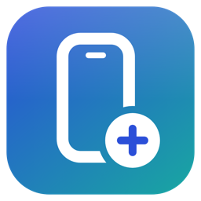
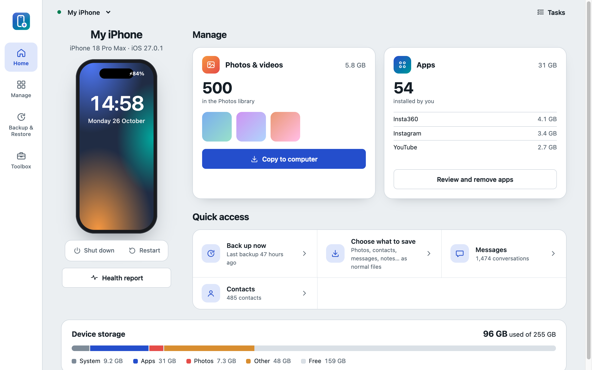
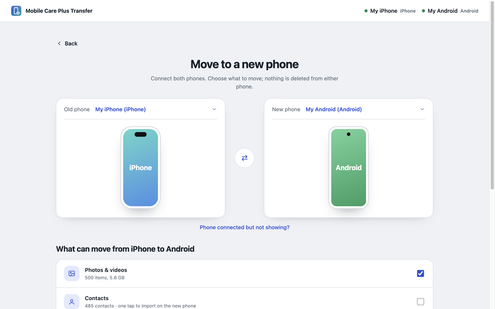
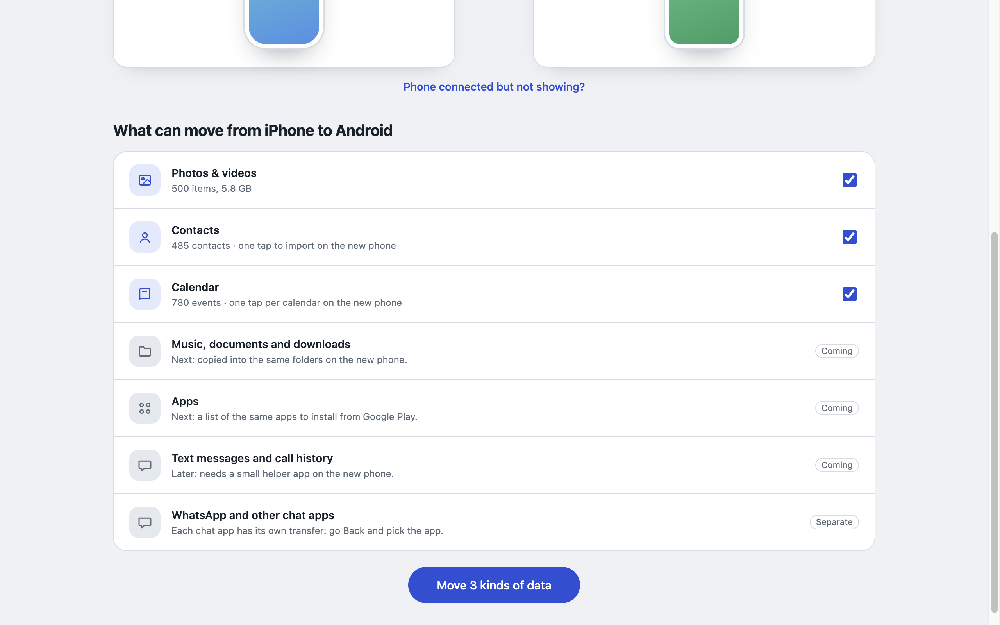
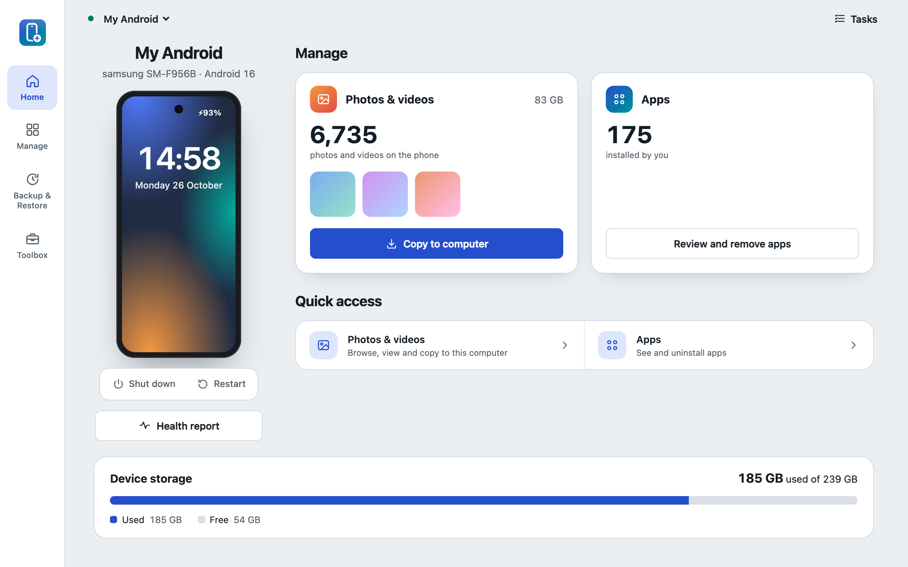
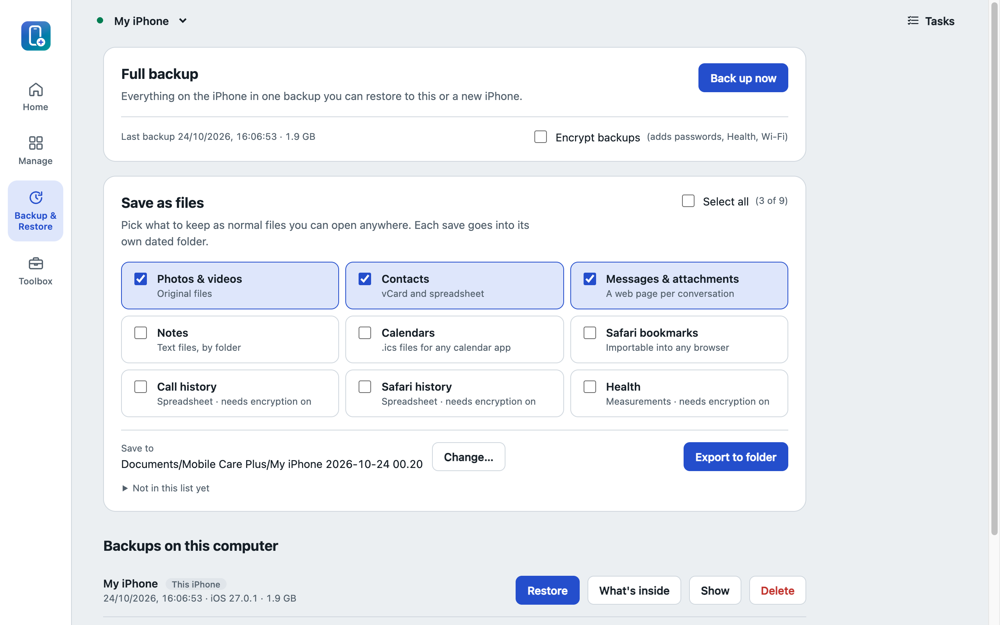
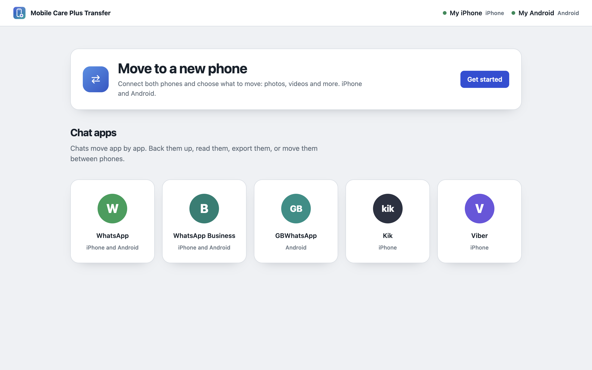
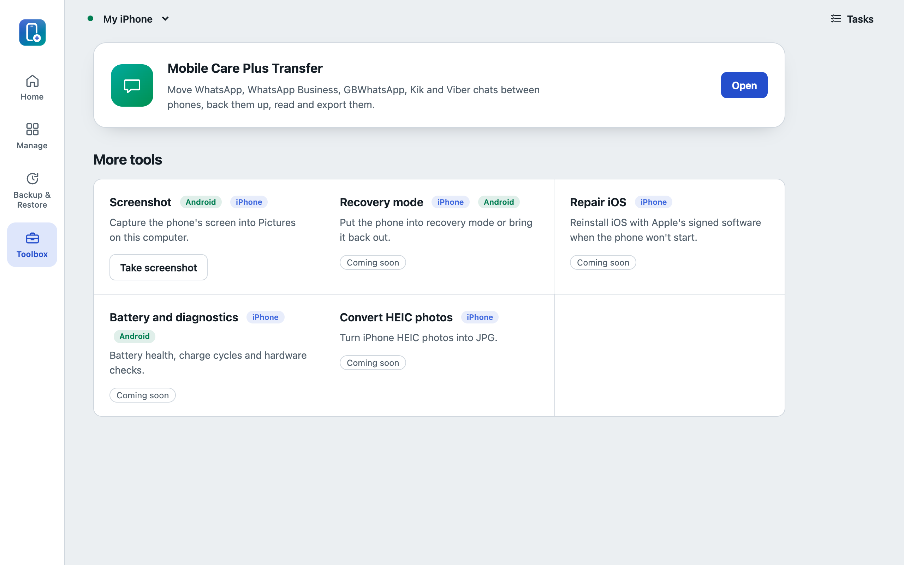

# Mobile Care Plus

Manage your iPhone and Android phone from your computer: back up and restore, browse and copy
photos and videos, manage apps, and move your data to a new phone. Everything runs on your
computer over a USB cable; nothing is uploaded anywhere.

> **Early preview (0.1.0).** It works, and we use it on our own phones, but it's new: expect rough
> edges and please [tell us](#contributing) what you find.

## Download

Get the latest installer from **[Releases](../../releases)**.

| System | File |
|---|---|
| Windows 10/11 (64-bit) | `Mobile-Care-Plus-Setup-<version>.exe` |
| macOS 27 on Apple Silicon (M1 or newer) | `Mobile-Care-Plus-<version>-mac-arm64.dmg` |

**Requirements:** Windows 10 or 11 (64-bit), or macOS 27 on an Apple Silicon Mac; about 450 MB of
free disk space (plus room for your backups); and a USB cable that carries data (not a
charge-only cable).

**Tested on:** iPhone 18 Pro Max (iOS 27) and Samsung Galaxy Z Fold6 (Android 16). Other recent
phones should work; [let us know](#contributing) how yours does.

## Before you connect a phone

**iPhone**
- Windows: install Apple's **Apple Devices** app from the Microsoft Store (it provides the iPhone USB driver).
- Unlock the iPhone and tap **Trust** when it asks.

**Android**
- Settings › About phone: tap **Build number** 7 times to turn on Developer options.
- Developer options: turn on **USB debugging**, then tap **Allow** on the phone when asked.
- Samsung phones on Windows may also need Samsung's **Android USB Driver**.

## Installing on a Mac

Open the `.dmg` and drag **Mobile Care Plus** to Applications. The app isn't notarized by Apple yet,
so the first time macOS says it can't check it: open **System Settings › Privacy & Security**, scroll
down and click **Open Anyway** next to Mobile Care Plus. iPhones and Android phones need no extra
drivers on a Mac.

## Installing on Windows

The installer isn't code-signed yet, so Windows shows "Windows protected your PC". Click
**More info**, then **Run anyway**. See below for why, and how to check the file first.

## Is it safe to install?

Fair question for any app that connects to your phone. Here is exactly what Mobile Care Plus does
and doesn't do.

**Why Windows and macOS warn you.** Windows warns about new apps that aren't signed with a paid
certificate, and macOS about apps Apple hasn't notarized. The warning means "your computer doesn't
know this app yet", not "this app is harmful". Signing is planned.

**No internet, no account.** Mobile Care Plus doesn't connect to the internet. There's no account
to create, no ads, no analytics or tracking, and no automatic updates. Nothing from your phone is
uploaded anywhere.

**Your phone, your say.** It only reads your phone over the USB cable while it's connected and you
use it. It changes your phone only when you choose to (restore, delete, move), and asks first.
Deleted photos go to the phone's own Trash where the phone has one, so you can get them back.
Backup passwords and WhatsApp's 64-digit key are used for one job and never saved.

**Check the download yourself.**
1. Compare the file's fingerprint with the one in the release notes. In Windows PowerShell:
   `Get-FileHash .\Mobile-Care-Plus-Setup-<version>.exe`; on a Mac, in Terminal:
   `shasum -a 256 Mobile-Care-Plus-<version>-mac-arm64.dmg`. If the two match, your file is exactly
   the one published here.
2. Scan it with dozens of antivirus engines at once on [VirusTotal](https://www.virustotal.com).
   Each release links its own scan report.

**Open source.** Every line of Mobile Care Plus is in this repository, so anyone can check exactly
what it does, or build it themselves ([docs/DEVELOPMENT.md](docs/DEVELOPMENT.md)). The open-source parts
it's built on are listed in [THIRD-PARTY-NOTICES.txt](THIRD-PARTY-NOTICES.txt).

**Removing it.** Uninstall it like any app: on Windows, Settings › Apps › Installed apps; on a Mac,
drag it from Applications to the Bin. Files it saved
for you (backups, exports, screenshots) stay in your folders until you delete them.

## What it does

| Feature | iPhone | Android |
|---|:---:|:---:|
| Phone info: model, system version, battery, storage | ✓ | ✓ |
| Restart and shut down the phone | ✓ | ✓ |
| Photos & videos: browse by date and album, view full size, copy to computer | ✓ | ✓ |
| Delete photos and videos | Mac only for now | ✓ (to the phone's Trash) |
| Apps: see them with their icons, uninstall | ✓ | ✓ |
| Full phone backup and restore, optionally encrypted | ✓ | — ¹ |
| Save as files: photos, contacts, calendars, and more | ✓ (9 kinds) | ✓ (3 kinds) |
| Restore saved files to the phone | — | ✓ |
| Read and export contacts and messages | ✓ | — |
| Move to a new phone | ✓ from iPhone | ✓ to and from Android |
| WhatsApp: back up, read and export chats | ✓ | ✓ ² (new) |
| Screenshot of the phone's screen | Limited ³ | ✓ |

¹ Android doesn't allow full backups to a computer; apps and settings move with your Google account.
² Reading Android chats needs WhatsApp's end-to-end encrypted backup with its 64-digit key. New in this version and still being tested with real backups.
³ iPhones only allow it in Developer Mode, and recent iOS versions often refuse even then.

**Move to a new phone, today:** photos & videos, contacts and calendars can move **to an Android
phone**, from an iPhone or another Android phone. Moving data **into an iPhone** is being built (see
below).

## Upcoming features

What we're working on, roughly in order. Want one sooner? [Tell us](#contributing).

- **Move into an iPhone:** contacts, calendars, and photos & videos from an Android phone or an old iPhone.
- **More to move between phones:** music, documents and downloads; reinstalling the same apps on a new Android phone.
- **WhatsApp phone to phone:** move chats directly between Android and iPhone, and restore a saved backup to a phone.
- **More chat apps:** Kik and Viber.
- **Text messages and call history** to a new phone.
- **More Macs:** older macOS versions and Intel Macs.
- **Signed installers**, so Windows and macOS don't warn.
- **Toolbox:** recovery mode, iOS repair, battery health and diagnostics, HEIC to JPG conversion.
- **On Windows:** deleting iPhone photos, and full-size HEIC photos in the viewer.

## Screenshots

**Move to a new phone**: choose the old and the new phone, then see exactly what can move in that direction.

**Works with Android too**

**Backup & Restore**: full backups, or just the data you pick, as normal files.

**Chat transfer and tools**

## Questions

**Is it free?** Yes. No trial, no subscription, no ads.

**Do I need iTunes?** No. On Windows, iPhones only need Apple's free **Apple Devices** app for the
USB driver. Nothing else.

**Does it work over Wi-Fi?** No, only over a USB cable. That keeps it simple and private.

**Can it move my data from Android to a new iPhone?** Not yet; that's the first item in
[Upcoming features](#upcoming-features). Moving to an Android phone works today.

**Why does Android need "USB debugging"?** It's the way Android lets a computer reach the phone's
photos, apps and data. You can turn it off again in Developer options when you're done.

**My iPhone backups are encrypted. Can I still use them?** Yes. Enter the backup password when asked;
it's used for that job only and never saved.

**Where are my files?** Exports are saved to *Documents › Mobile Care Plus* (you can choose another
folder), screenshots to *Pictures › Mobile Care Plus*, and full iPhone backups to the app's own folder
(*%AppData% › Mobile Care Plus* on Windows).

## Release notes

See [CHANGELOG.md](CHANGELOG.md) for what's new in each version.

## Contributing

Mobile Care Plus is open source, and contributions are welcome: code, bug reports, telling us which
phones work, and feature ideas. Start with [CONTRIBUTING.md](CONTRIBUTING.md); to run the app from source,
see [docs/DEVELOPMENT.md](docs/DEVELOPMENT.md).

If Mobile Care Plus is useful to you, **star the repository**: it helps other people find it.

## Why we built it

Mobile Care Plus was inspired by Tenorshare iCareFone. We liked the idea of one tool that looks
after your phone from your computer, so we built our own software from scratch: our own code,
design and features, for both iPhone and Android, free and open source.

## License

Mobile Care Plus is free and open source under the [GNU General Public License v3.0](LICENSE) (or any
later version): you can use, study, share and change it, and changed versions you share must stay open
source under the same license. It includes open-source components listed in
[THIRD-PARTY-NOTICES.txt](THIRD-PARTY-NOTICES.txt); the helper tools in [native/](native) build on
libimobiledevice (LGPL-2.1).

Mobile Care Plus isn't affiliated with, endorsed by or connected to Tenorshare, Apple, Google, Samsung or
WhatsApp. iCareFone is a trademark of Tenorshare; iPhone is a trademark of Apple Inc.; Android is a
trademark of Google LLC.
